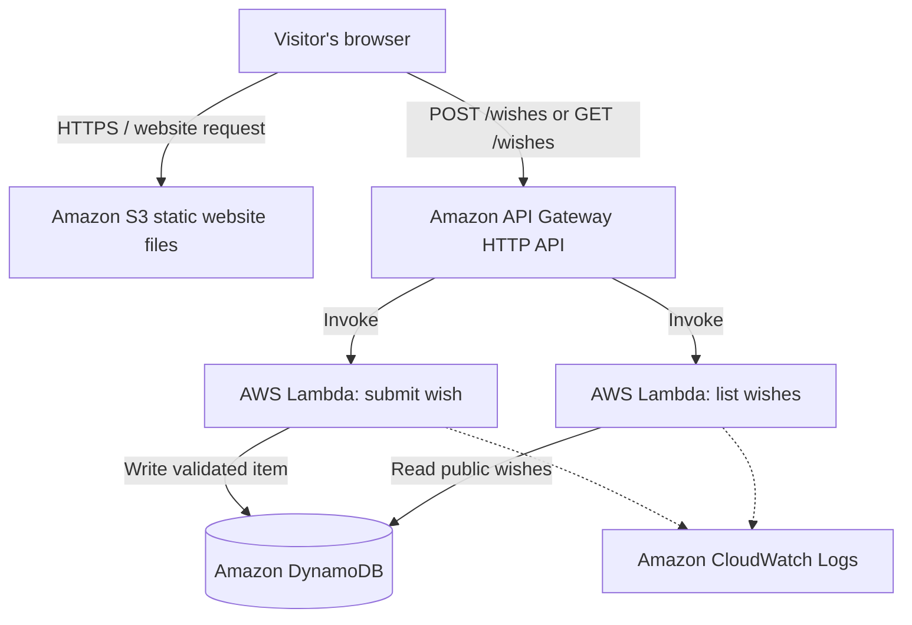

# Deepawali Cloud — Powered by AWS

A festive, serverless Diwali greetings website where visitors can submit a wish and read greetings shared by the community.

> **Project status:** Planning / development  
> **Target AWS Region:** Asia Pacific (Mumbai) — `ap-south-1`  
> **Budget ceiling:** ₹100–₹200 (hard budget target, not a guaranteed AWS billing cap)

## What we're building

- A festive landing page with animated diyas and a Diwali-inspired background.
- A form for visitors to submit their name and greeting.
- A public wishes wall displaying submitted greetings.
- A serverless backend built with AWS managed services.

## Planned architecture



IAM execution roles grant each Lambda function only the DynamoDB permissions it needs. The browser will never contain AWS access keys or credentials.

### AWS services and responsibilities

| Service | Responsibility |
|---|---|
| Amazon S3 | Store and serve the static frontend files |
| Amazon API Gateway (HTTP API) | Expose the application endpoints |
| AWS Lambda | Validate requests and process wishes |
| Amazon DynamoDB | Store submitted greetings |
| AWS IAM | Apply least-privilege permissions |
| Amazon CloudWatch | Collect application logs and support monitoring |

## Planned API

| Method | Route | Purpose |
|---|---|---|
| `POST` | `/wishes` | Validate and save a greeting |
| `GET` | `/wishes` | Return public greetings |

The implementation will validate and limit user input, handle errors safely, and avoid exposing internal error details to visitors. The public read endpoint will return only fields intended for display.

## Security checklist

- [ ] No AWS credentials or secrets in frontend code or Git.
- [ ] Separate Lambda execution roles with least-privilege DynamoDB access.
- [ ] Validate input on the backend; enforce name and greeting length limits.
- [ ] Configure API throttling and consider abuse/spam controls.
- [ ] Enable appropriate CloudWatch logging and set a deliberate log-retention period.
- [ ] Review S3 public-access settings and the chosen website-delivery design.
- [ ] Use HTTPS for the public site and API.
- [ ] Keep deployment permissions separate from runtime permissions.

## Cost discipline

This project is being built in an AWS **Pay-As-You-Go** account. Free Tier eligibility must not be assumed.

- Check current prices for the selected region and service configuration before creating resources.
- Keep the workload small and avoid EC2, RDS, and NAT Gateway.
- Set AWS Budgets alerts and review actual usage and billing regularly.
- Remember: budget alerts notify you; they do **not** impose a hard spending limit.
- Account for possible taxes, data transfer, logging, domain, and HTTPS-delivery costs.
- Delete project resources after the demonstration if they are no longer needed.

The ₹100–₹200 figure is a spending target, not a price quote or guarantee. No AWS resources have been deployed as part of this repository update.

## Repository structure

```text
deepawali-cloud/
├── frontend/
│   ├── index.html
│   ├── css/
│   │   └── style.css
│   ├── js/
│   │   └── app.js
│   └── assets/
│       ├── diyas/
│       └── backgrounds/
├── backend/
│   ├── submit_wish/
│   │   └── lambda_function.py
│   └── get_wishes/
│       └── lambda_function.py
├── infrastructure/
│   └── iam/
├── docs/
│   └── architecture.md
└── README.md
```

This is the intended structure; folders and implementation files will be added as development progresses.

## Development plan

| Date | Planned work |
|---|---|
| 5 November 2026 | Architecture, billing safeguards, repository preparation |
| 6 November 2026 | DynamoDB design and Lambda backend |
| 7 November 2026 | Frontend, API integration, validation and testing |
| 8 November 2026 | Final security, HTTPS and cost review; launch only if checks pass |

Dates are targets, not a claim that these milestones are complete.

## Learning outcomes

- Understand a serverless request flow from browser to API Gateway to Lambda.
- Use Lambda execution roles to access DynamoDB securely.
- Design and test HTTP API endpoints.
- Apply input validation and basic public-API security controls.
- Monitor application behaviour and costs with AWS tools.

## Cleanup

When the project is no longer needed, remove the API Gateway API, Lambda functions, DynamoDB table, S3 objects and bucket, and any project-specific log groups or IAM roles/policies that are safe to remove. Check dependencies and verify the billing dashboard after cleanup.

---

Built as a hands-on AWS learning project. The goal is to understand each service and security decision—not simply deploy a working website.
